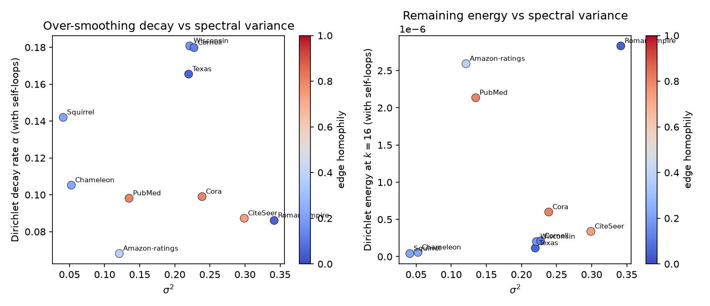
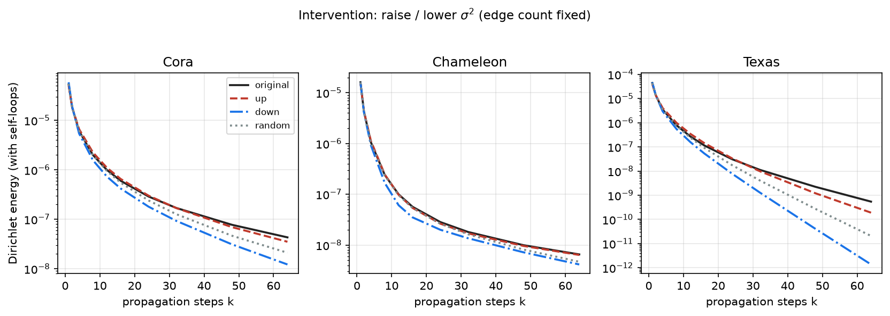

# Pilot: does normalised-Laplacian eigenvalue variance predict GNN over-smoothing?

Quick CPU-only pilot, not a paper. The question is whether

\[\sigma^2=\frac1n\|\mathcal{L}\|_F^2-\mu^2\]

(which equals \(\frac2n\sum_{(i,j)\in E} 1/(d_i d_j)\) when there are no isolates) tracks over-smoothing and node-classification accuracy, especially on heterophilic graphs.

## What was run

- **Graphs.** Largest connected component of the undirected simple graph, self-loops removed for statistics and for \(\sigma^2\). GCN and SGC still use the Kipf–Welling renormalisation \(P=\tilde D^{-1/2}(A+I)\tilde D^{-1/2}\). Over-smoothing curves were computed both with and without self-loops in the propagator.
- **Datasets that loaded (all ten succeeded).** Cora, CiteSeer, PubMed (Planetoid); Texas, Wisconsin, Cornell (WebKB / geom-GCN official splits); Chameleon, Squirrel (Wikipedia / geom-GCN dumps from commit `f1fc0d1`, known duplicate-node caveat); Roman-empire and Amazon-ratings (Platonov et al., official splits).
- **Splits.** Official Planetoid split with random initialisations on Cora/CiteSeer, restricted to the LCC; official geom-GCN or Platonov splits otherwise, also restricted to the LCC.
- **Original-graph models.** GCN-2 and GCN-8 (hidden 32, Adam lr=0.01, weight decay \(5\times10^{-4}\), dropout 0.5, early stopping on validation accuracy, 5 seeds) and SGC with \(k=2\) and \(k=10\) (ℓ2-regularised logistic regression on the propagated features). An extra GCN-16 was run on the three WebKB graphs only. **Not trained:** PubMed, Roman-empire, Amazon-ratings (left as statistics + over-smoothing only); Squirrel (training was started, then dropped — SGC on 5k nodes × 2k features was too slow on this CPU budget).
- **Intervention (the causal test).** On Cora, Chameleon and Texas: greedy delete+add rewires scored by the exact T2 \(\Delta\sigma^2\) formula, rejecting swaps that disconnect the graph or create isolates. The target was ±20% in \(\sigma^2\) at fixed edge count, so \(\langle d\rangle\) is invariant. A random-rewire control used the median number of accepted swaps. The same GCN-2 / GCN-8 models were then retrained (5 seeds on Cora and Texas; 3 official splits on Chameleon). Intervention SGC was rerun afterwards with a working solver on Cora and Texas; **Chameleon intervention SGC was still running when this report was written and is not in the tables.**

CiteSeer drops from 3327 to 2120 nodes on the LCC (many isolates); Cora drops 2708→2485. Accuracies below are on these LCCs and are not directly comparable to full-graph Planetoid numbers. Roman-empire's spectral gap did not converge with ARPACK and is left missing, not imputed.

## Dataset statistics

Computed on the LCC. \(\sigma^2\langle d\rangle=1\) exactly on a regular graph; deviations reflect degree heterogeneity. Edge homophily is the fraction of edges with the same label on both ends. The spectral gap is \(\lambda_2\) of the normalised Laplacian (no self-loops).

| Dataset | n (LCC / full) | edges | \(\sigma^2\) | \(\langle d\rangle\) | \(\sigma^2\langle d\rangle\) | edge h | gap |
|---|---:|---:|---:|---:|---:|---:|---:|
| Cora | 2485 / 2708 | 5069 | 0.2389 | 4.08 | 0.975 | 0.804 | 0.0048 |
| CiteSeer | 2120 / 3327 | 3679 | 0.2990 | 3.47 | 1.038 | 0.735 | 0.0016 |
| PubMed | 19717 / 19717 | 44324 | 0.1349 | 4.50 | 0.606 | 0.802 | 0.0141 |
| Texas | 183 / 183 | 279 | 0.2197 | 3.05 | 0.670 | 0.061 | 0.0632 |
| Wisconsin | 251 / 251 | 450 | 0.2213 | 3.59 | 0.794 | 0.178 | 0.0765 |
| Cornell | 183 / 183 | 277 | 0.2274 | 3.03 | 0.688 | 0.123 | 0.0797 |
| Chameleon | 2277 / 2277 | 31371 | 0.0526 | 27.55 | 1.450 | 0.230 | 0.0064 |
| Squirrel | 5201 / 5201 | 198353 | 0.0410 | 76.27 | 3.130 | 0.222 | 0.0437 |
| Roman-empire | 22662 / 22662 | 32927 | 0.3415 | 2.91 | 0.992 | 0.047 | — |
| Amazon-ratings | 24492 / 24492 | 93050 | 0.1210 | 7.60 | 0.919 | 0.380 | 0.0001 |

Two observations already cut against a simple “high \(\sigma^2\) means heterophily” story. The WebKB graphs have \(\sigma^2\approx 0.22\), similar to Cora, but much lower homophily. Chameleon and Squirrel are heterophilic yet have *low* \(\sigma^2\) because they are dense. Roman-empire combines the lowest homophily (0.047) with the *highest* \(\sigma^2\) (0.342).

## Over-smoothing curves and cross-dataset correlations

Features were row-normalised and propagated as \(X^{(k)}=S^k X\). Dirichlet energy is \(\frac1{nf}\mathrm{Tr}(X^\top\mathcal{L} X)\). The decay rate \(\alpha\) is a log-linear fit of energy versus \(k\ge 1\). Mean cosine distance (MAD) used up to 8000 random node pairs. The half-life relative to \(k=1\) was 2 on *every* dataset with self-loops, so that particular summary is not discriminative.

| Dataset | \(\alpha\) (loops) | \(R^2\) | energy \(k=16\) | \(\alpha\) (no loops) | energy \(k=16\) (no loops) |
|---|---:|---:|---:|---:|---:|
| Cora | 0.099 | 0.80 | 5.99e-07 | 0.115 | 1.43e-06 |
| CiteSeer | 0.087 | 0.78 | 3.39e-07 | 0.091 | 2.43e-06 |
| PubMed | 0.098 | 0.80 | 2.14e-06 | 0.105 | 9.50e-06 |
| Texas | 0.166 | 0.89 | 1.14e-07 | 0.170 | 1.59e-06 |
| Wisconsin | 0.181 | 0.95 | 2.02e-07 | 0.219 | 6.95e-07 |
| Cornell | 0.180 | 0.95 | 2.12e-07 | 0.224 | 1.32e-06 |
| Chameleon | 0.105 | 0.71 | 5.66e-08 | 0.120 | 1.52e-07 |
| Squirrel | 0.142 | 0.85 | 4.10e-08 | 0.161 | 5.12e-08 |
| Roman-empire | 0.086 | 0.77 | 2.83e-06 | 0.116 | 7.85e-06 |
| Amazon-ratings | 0.068 | 0.70 | 2.59e-06 | 0.080 | 2.68e-06 |

Spearman correlations across the ten datasets (nine for the gap). These are correlations, not proof; \(n\approx 10\) is small, and p-values are only a rough flag.

**With self-loops (closer to GCN / SGC):**

| Target | vs \(\sigma^2\) | vs \(1/\langle d\rangle\) | vs \(\sigma^2\langle d\rangle\) | vs homophily | vs spectral gap | \(\sigma^2\) after \(1/\langle d\rangle\) + h |
|---|---|---|---|---|---|---|
| \(\alpha\) | r=−0.18 (p=0.63, n=10) | r=0.08 (p=0.83, n=10) | r=−0.22 (p=0.53, n=10) | r=−0.36 (p=0.31, n=10) | r=0.93 (p=0.0002, n=9) | r=−0.55 (p=0.098) |
| energy at k=16 | r=0.55 (p=0.098, n=10) | r=0.38 (p=0.28, n=10) | r=−0.30 (p=0.40, n=10) | r=0.18 (p=0.63, n=10) | r=−0.57 (p=0.11, n=9) | r=0.16 (p=0.65) |
| MAD at k=16 | r=0.13 (p=0.73, n=10) | r=−0.26 (p=0.47, n=10) | r=0.42 (p=0.23, n=10) | r=0.65 (p=0.043, n=10) | r=−0.68 (p=0.042, n=9) | r=0.31 (p=0.38) |

**Without self-loops:**

| Target | vs \(\sigma^2\) | vs \(1/\langle d\rangle\) | vs \(\sigma^2\langle d\rangle\) | vs homophily | vs spectral gap | \(\sigma^2\) after \(1/\langle d\rangle\) + h |
|---|---|---|---|---|---|---|
| \(\alpha\) | r=−0.05 (p=0.88, n=10) | r=0.28 (p=0.43, n=10) | r=−0.16 (p=0.65, n=10) | r=−0.66 (p=0.038, n=10) | r=0.95 (p=9e-5, n=9) | r=−0.44 (p=0.20) |
| energy at k=16 | r=0.43 (p=0.21, n=10) | r=0.39 (p=0.26, n=10) | r=−0.48 (p=0.16, n=10) | r=0.14 (p=0.70, n=10) | r=−0.45 (p=0.22, n=9) | r=−0.21 (p=0.56) |
| MAD at k=16 | r=0.12 (p=0.75, n=10) | r=−0.30 (p=0.40, n=10) | r=0.43 (p=0.21, n=10) | r=0.66 (p=0.038, n=10) | r=−0.73 (p=0.025, n=9) | r=0.27 (p=0.45) |

The only *strong* predictor of the Dirichlet decay rate is the spectral gap (\(r=0.93\) with self-loops, \(p=2\times10^{-4}\)). That is the expected linear-algebra fact: the decay of \(S^k\) is governed by the second-largest eigenvalue of \(S\). \(\sigma^2\) is only weakly related to \(\alpha\) (\(r=-0.18\), \(p=0.63\)). Energy remaining at \(k=16\) has a moderate raw association with \(\sigma^2\) (\(r=0.55\), \(p=0.10\)) that shrinks after controlling for \(1/\langle d\rangle\) and homophily (partial \(r=0.16\), \(p=0.65\)). The residual association of \(\sigma^2\) with \(\alpha\) after those controls is larger but still inconclusive (partial \(r=-0.55\), \(p=0.098\)).

Homophily itself correlates with MAD at \(k=16\) (\(r=0.65\), \(p=0.04\)): more homophilic graphs keep more feature similarity under propagation. That is expected, and it is not a \(\sigma^2\) effect.

See [figures/sigma2_vs_oversmoothing.png](figures/sigma2_vs_oversmoothing.png): WebKB sits at mid \(\sigma^2\) and *fast* decay; Squirrel has low \(\sigma^2\) but relatively fast decay; there is no monotone \(\sigma^2\)–\(\alpha\) trend.

## Original-graph accuracy

Test accuracy mean±std over 5 seeds (Planetoid: one official split, varying initialisation; WebKB/Wikipedia: first 5 official splits). SGC on Planetoid is deterministic given the split, so the std is zero.

| Dataset | GCN-2 | GCN-8 | SGC-2 | SGC-10 | \(\sigma^2\) | h |
|---|---:|---:|---:|---:|---:|---:|
| Cora | 0.809±0.002 | 0.645±0.063 | 0.690 | 0.727 | 0.239 | 0.804 |
| CiteSeer | 0.703±0.015 | 0.507±0.108 | 0.526 | 0.584 | 0.299 | 0.735 |
| Texas | 0.573±0.052 | 0.584±0.063 | 0.492±0.059 | 0.454±0.052 | 0.220 | 0.061 |
| Wisconsin | 0.541±0.085 | 0.486±0.105 | 0.537±0.030 | 0.404±0.029 | 0.221 | 0.178 |
| Cornell | 0.448±0.056 | 0.443±0.063 | 0.389±0.053 | 0.340±0.085 | 0.227 | 0.123 |
| Chameleon | 0.619±0.020 | 0.389±0.053 | 0.696±0.024 | 0.558±0.027 | 0.053 | 0.230 |

GCN-16 on the WebKB originals was 0.584±0.062 (Texas), 0.463±0.072 (Wisconsin), and 0.443±0.062 (Cornell): no gain over GCN-8.

Across these six trained datasets, Spearman of GCN-2 test accuracy with \(\sigma^2\) is r=0.37 (p=0.47); with edge homophily it is r=0.83 (p=0.042). The GCN-2 minus GCN-8 drop (a crude over-smoothing cost) versus \(\sigma^2\) is r=0.09 (p=0.87); versus homophily it is r=0.77 (p=0.072). Deep GCN-8 is unstable and usually worse than GCN-2 in this residual-free setup, on both homophilic and heterophilic graphs. That drop is real, but it is not larger where \(\sigma^2\) is large: Chameleon has *low* \(\sigma^2\) and still a large deep-GCN drop (0.619→0.389).

## Intervention (the causal test)

Edge count, and therefore \(\langle d\rangle\), is fixed by construction. Homophily and the spectral gap can still move; both are reported so that a change in over-smoothing or accuracy is not automatically attributed to \(\sigma^2\).

Cora “up” reached only +13% (the 10–30% band) after 137 improving swaps and then stalled. Cora “down” and both Chameleon and Texas directions hit the ±20% target.

| Graph | variant | \(\sigma^2\) | rel. change | \(\langle d\rangle\) | edge h | gap (no loops) | gap (loops) | \(\alpha\) (loops) | energy \(k=16\) | swaps |
|---|---|---:|---:|---:|---:|---:|---:|---:|---:|---:|
| Cora | original | 0.2389 | — | 4.080 | 0.804 | 0.0048 | 0.0036 | 0.099 | 5.99e-07 | — |
| Cora | up | 0.2701 | +13.0% | 4.080 | 0.787 | 0.0098 | 0.0076 | 0.103 | 6.51e-07 | 137 |
| Cora | down | 0.1910 | −20.0% | 4.080 | 0.765 | 0.0232 | 0.0188 | 0.119 | 4.18e-07 | 311 |
| Cora | random | 0.2382 | −0.3% | 4.080 | 0.777 | 0.0155 | 0.0115 | 0.111 | 5.49e-07 | 224 |
| Chameleon | original | 0.0526 | — | 27.555 | 0.230 | 0.0064 | 0.0062 | 0.105 | 5.66e-08 | — |
| Chameleon | up | 0.0633 | +20.3% | 27.555 | 0.230 | 0.0066 | 0.0064 | 0.106 | 5.39e-08 | 64 |
| Chameleon | down | 0.0421 | −20.0% | 27.555 | 0.229 | 0.0120 | 0.0116 | 0.110 | 3.50e-08 | 362 |
| Chameleon | random | 0.0527 | +0.1% | 27.555 | 0.230 | 0.0104 | 0.0101 | 0.110 | 5.37e-08 | 213 |
| Texas | original | 0.2197 | — | 3.049 | 0.061 | 0.0632 | 0.0404 | 0.166 | 1.14e-07 | — |
| Texas | up | 0.2655 | +20.8% | 3.049 | 0.079 | 0.0788 | 0.0499 | 0.183 | 1.43e-07 | 9 |
| Texas | down | 0.1732 | −21.2% | 3.049 | 0.075 | 0.1354 | 0.0956 | 0.259 | 5.33e-08 | 15 |
| Texas | random | 0.2247 | +2.3% | 3.049 | 0.075 | 0.1086 | 0.0715 | 0.217 | 9.08e-08 | 12 |

The important confound is the gap. Lowering \(\sigma^2\) *increased* \(\lambda_2\) on all three graphs (Cora 0.0048→0.0232, Chameleon 0.0064→0.0120, Texas 0.0632→0.1354), and Dirichlet energy then decayed *faster*, not slower. Random rewires, which barely move \(\sigma^2\), also increased the gap and \(\alpha\). See [figures/intervention_oversmoothing_curves.png](figures/intervention_oversmoothing_curves.png): the “down” curves fall slightly below the others, with Texas the most visible, and random sits between original and down on Cora and Texas.

 So this intervention is not a pure \(\sigma^2\) knob; it is partly a gap intervention, and random edits already move the gap.

Homophily also moved on Cora (0.804→0.765 on “down”, 0.777 on random). It was essentially unchanged on Chameleon and rose slightly on Texas.

Test accuracy after rewiring (mean±std). Cora and Texas use 5 seeds for GCN; Cora SGC uses the single official split (deterministic). Chameleon GCN uses 3 official splits. Chameleon intervention SGC is not reported.

| Dataset | model | original | \(\sigma^2\uparrow\) | \(\sigma^2\downarrow\) | random rewire |
|---|---|---:|---:|---:|---:|
| Cora | GCN-2 | 0.809±0.002 | 0.788±0.003 | 0.795±0.012 | 0.799±0.005 |
| Cora | GCN-8 | 0.645±0.063 | 0.592±0.079 | 0.462±0.158 | 0.592±0.057 |
| Cora | SGC-2 | 0.690 | 0.683 | 0.677 | 0.691 |
| Cora | SGC-10 | 0.727 | 0.598 | 0.456 | 0.530 |
| Chameleon | GCN-2 | 0.619±0.020 | 0.604±0.033 | 0.598±0.029 | 0.631±0.029 |
| Chameleon | GCN-8 | 0.389±0.053 | 0.368±0.039 | 0.414±0.045 | 0.403±0.065 |
| Texas | GCN-2 | 0.573±0.052 | 0.578±0.056 | 0.600±0.044 | 0.578±0.041 |
| Texas | GCN-8 | 0.584±0.063 | 0.584±0.062 | 0.584±0.062 | 0.584±0.062 |
| Texas | SGC-2 | 0.492±0.059 | 0.584±0.062 | 0.584±0.062 | 0.584±0.062 |
| Texas | SGC-10 | 0.454±0.052 | 0.584±0.062 | 0.584±0.062 | 0.584±0.062 |

On Cora, every rewire slightly hurts GCN-2; the \(\sigma^2\uparrow\) drop is a little larger than random, but all three are within about two points of the original. Deep models do not show a benefit from lowering \(\sigma^2\): Cora GCN-8 “down” is the *worst* mean (0.462) but with huge seed variance (one run collapsed to 0.219). Cora SGC-10, which is the cleanest deep-propagator number here, falls in lockstep with the *gap*, not with the sign of \(\Delta\sigma^2\): original 0.727 (gap 0.0036) → up 0.598 (0.0076) → random 0.530 (0.0115) → down 0.456 (0.0188). Faster decay after a “down” rewire means more over-smoothing at a fixed large \(k\), and accuracy falls.

Chameleon GCN changes are small, overlap the random control, and sit inside split noise (n=3). Texas GCN-8 and all Texas intervention SGC runs produced the same per-split accuracies as each other (means 0.584); on this 183-node graph the deep models appear insensitive to these few rewires.

If \(\sigma^2\) were a causal driver of over-smoothing in the hoped-for direction, raising it should deepen the deep-model drop relative to a same-budget random rewire, and lowering it should help. That pattern is not there. The movement that does show up (Cora SGC-10) is better explained by the spectral gap.

## Verdict

**Weak, and on this evidence closer to negative than promising, as a predictor of over-smoothing, accuracy, or heterophily.**

The quantity that actually tracks Dirichlet decay across datasets is the spectral gap, not \(\sigma^2\). \(\sigma^2\) does not line up with edge homophily, does not explain GCN-2 accuracy once homophily is taken into account, and does not explain the shallow-versus-deep accuracy drop. The rewiring test, which holds \(\langle d\rangle\) fixed, shows that greedy \(\sigma^2\)-down edits systematically *increase* the gap and *accelerate* energy decay; on Cora that made SGC-10 *worse*, including relative to a random rewire. A narrower follow-up that remains conceivable is whether \(\sigma^2\langle d\rangle\) (the deviation from the regular-graph law) or a gap-conditioned residual of \(\sigma^2\) describes anything about the *shape* of the spectrum beyond \(\lambda_2\). This pilot does not support using \(\sigma^2\) itself as a cheap over-smoothing or heterophily score.

## Caveats

- Ten datasets (nine for the gap) is too few for a stable ranking correlation; a single extra point can move Spearman substantially. p-values here are descriptive.
- Cora and especially CiteSeer are evaluated on the LCC, not the full Planetoid graph.
- Chameleon and Squirrel have a documented data-quality issue (duplicate nodes). Classification numbers on those two should be treated cautiously.
- GCN-8 has no residual, identity mapping, or PairNorm; it is *meant* to over-smooth, and it is a noisy estimator of the deep regime (large seed-to-seed variance on Cora and CiteSeer).
- The Dirichlet half-life was 2 on every dataset with self-loops, so decay-*speed* summaries are more informative than that threshold.
- Squirrel, PubMed, Roman-empire, and Amazon-ratings were not used in the trained-GNN tables. Chameleon intervention SGC is missing. Roman-empire's spectral gap is missing.
- Intervention rewires change the gap (and, on Cora, homophily) even when \(\langle d\rangle\) is fixed; those confounds are in the intervention table. Random rewires already move the gap.
- No result here uses ogbn-arxiv or a GAT, and the pilot is CPU-only with hidden size 32.

## Artefacts

- [figures/sigma2_vs_oversmoothing.png](figures/sigma2_vs_oversmoothing.png)
- [figures/intervention_oversmoothing_curves.png](figures/intervention_oversmoothing_curves.png)
- [results/dataset_stats.json](results/dataset_stats.json)
- [results/oversmooth.json](results/oversmooth.json)
- [results/correlations.json](results/correlations.json)
- [results/interventions.json](results/interventions.json)
- [results/train_rows.json](results/train_rows.json)
